+++
date = '2026-10-19T21:32:06+09:00'
draft = false
title = 'The Long Way Down Day 0/1'
toc = false
+++

## Day 0/1: Kawasaki - Toyohashi - Aioi

### Friday

To maximize the time I could spend, I left for the trip after work on Friday. I wanted to stop at least once, though, and I hadn’t stopped in Numazu before, so I decided to stop there.

##### Numazu

Numazu is known for its commercial fish port, meaning there are lots of restaurants nearby serving locally sourced fish. It may not be a major tourist location with much to do, but it does have a viewpoint where you can look over the bay. Given that this trip is centered around 1-2 hour stops, it was a perfect stop. At the top of the three story viewpoint was a Georgia Cafe vending machine, so I enjoyed a hot chocolate while watching the sunset over the bay.

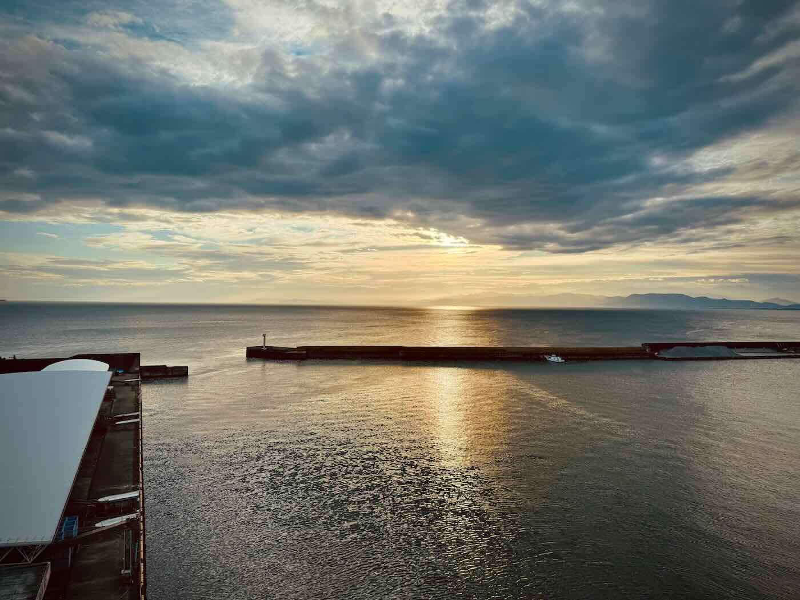

Before getting on the train to continue to the first city I’d be spending the night in, I wanted to try some of the local cuisine. I found a restaurant that served locally sourced tuna over rice bowls. I really liked the flavor of the tune, and it was topped with a whipped egg, which I had never had before. The flavor was quite interesting.

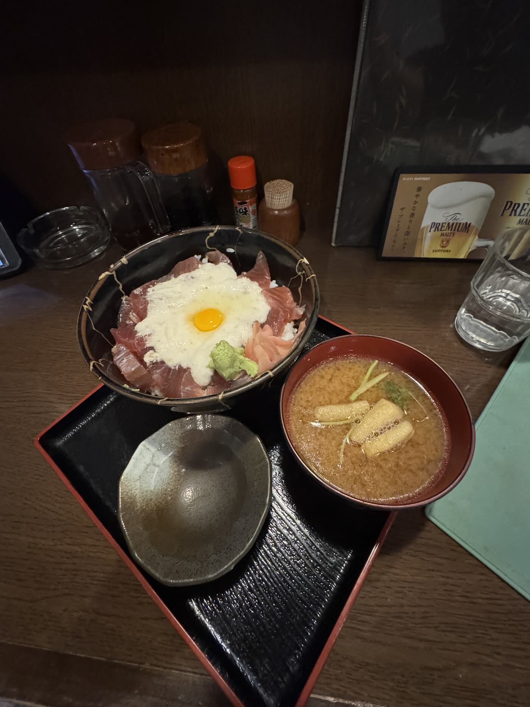

After dinner, the sun had set and it was time to take the train to my first overnight stay in Toyohashi.

The train leaving Numazu was a special express “Home Liner” train. It’s similar to a limited express in that it required a 330 yen surcharge and skips some stations, however as its main purpose is to serve commuters from Tokyo, it does not allow you to pick your seat and lacks some of the amenities of a limited express train. From there, I had a short layover in Hamamatsu, and then arrived in Toyohashi.

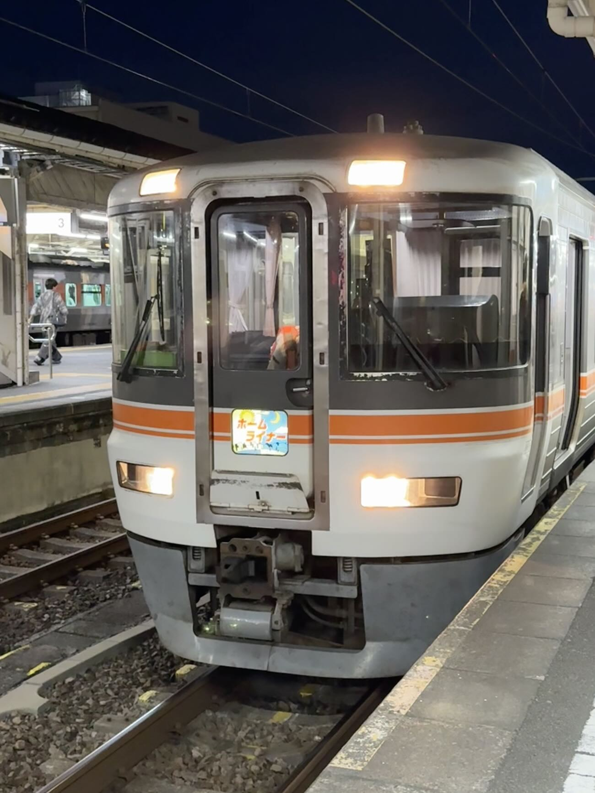

##### Toyohashi

In Toyohashi I stayed the night at a hotel called “New Toyo Hotel”. As with most of the hotels I’ll be staying at (all but Fukuoka, but more on that later), this was a standard business hotel. In case you are unfamiliar, Japanese business hotels are generally low-cost, small rooms with included amenities, optional breakfast, and sometimes an included public bath which is very nice on long trips. From my experience, the staff is always very welcoming and accommodating. For solo travelers, I highly recommend staying at business hotels.

### Saturday

After some a good nights sleep, I continued early the next morning. I decided to not eat breakfast at the hotel as I wanted to try a local cafe. It’s generally quite rare to find a cafe open earlier than 10 AM, 9 AM if you’re lucky, but I somehow found a cafe that opened at 6 AM. The breakfast set was a standard cafe breakfast, including toast, salad, eggs, and of course, coffee. The food was very good, and the coffee even better. The cafe had a local feel where all the elderly men gathered to read their newspapers and shoot the breeze.

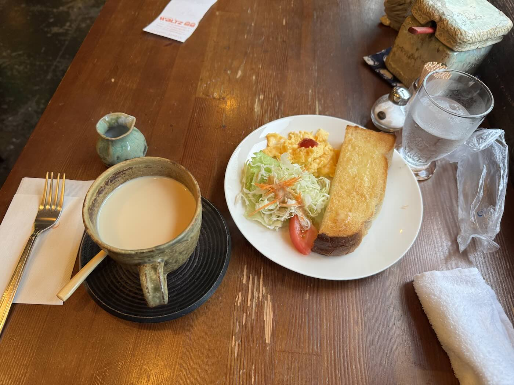

I then continued onward to Maibara. I passed through Nagoya, but decided not to stop as I had been there previously and it did not fit the spirit of the trip. In addition, I had boarded a special express train bound for Maibara when most trains would take much longer and would require a transfer.

#### Shiga

Just north of Kyoto in the Shiga prefecture is Lake Biwa. Around this lake are many towns and communities including two that I stopped at: Nagahama and Hikone. 

Stopping in Nagahama required a quick transfer in Maibara, but there is a castle and museum right outside the station. The castle grounds were quite interesting to explore, though as this was the day with the longest travel time, I only had a little under an hour to look around. This was just enough time to explore around the castle but I wasn’t able to visit the museum. This was fine with me as I would be taking a longer stop in Hikone to explore another castle a little more thoroughly.

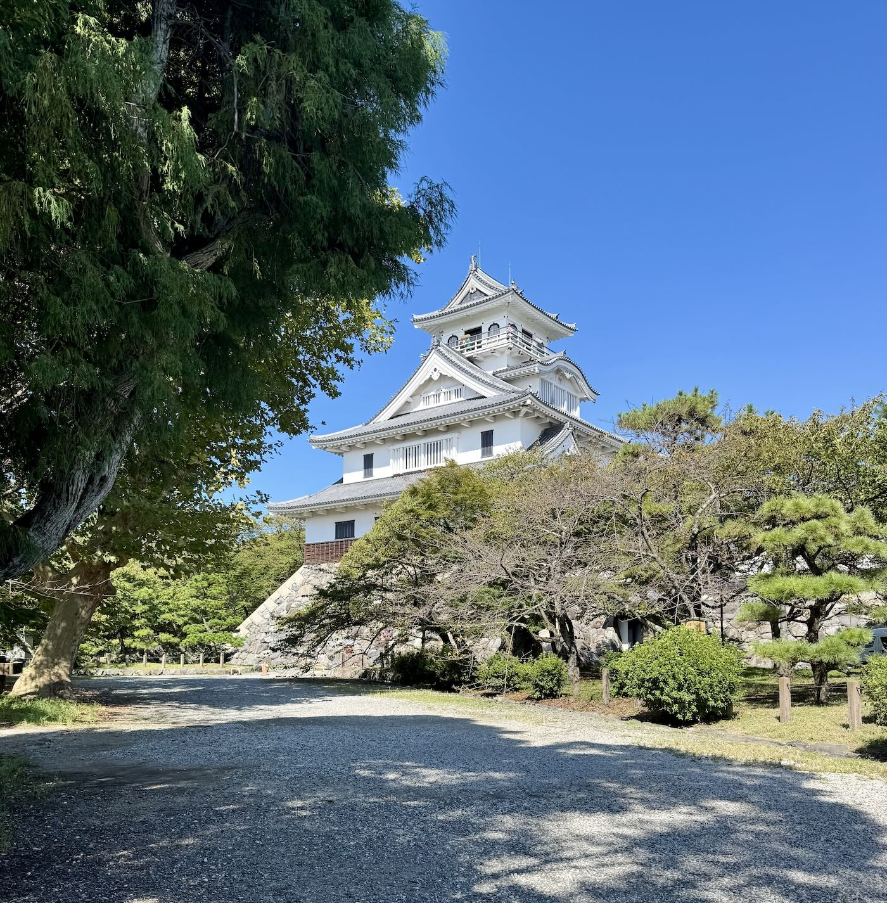

The castle grounds in Hikone are quite large with gardens and older-style buildings throughout. Walking around felt like a living museum. The main castle as well as the turrets were fully explorable with very few limitations on where you could and couldn’t go, as long as you didn’t wear shoes inside and could climb up the incredibly steep stairs. Some castles have museums inside the main castle building, however this one had the museum located in a different section.

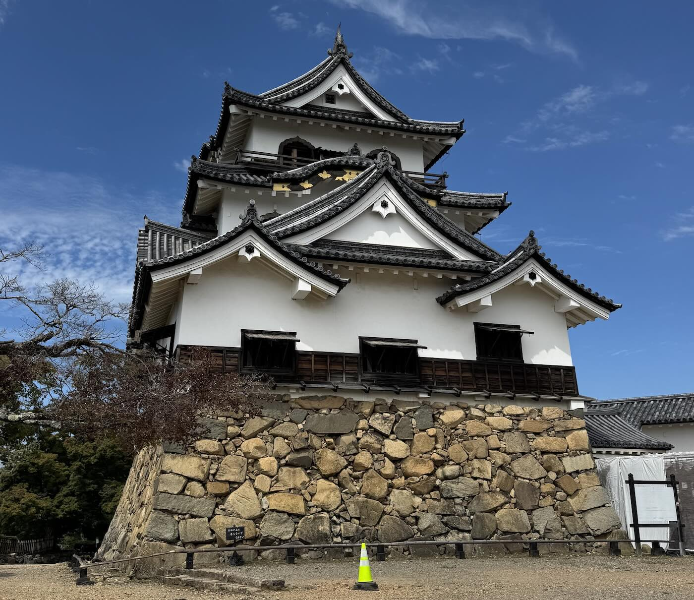

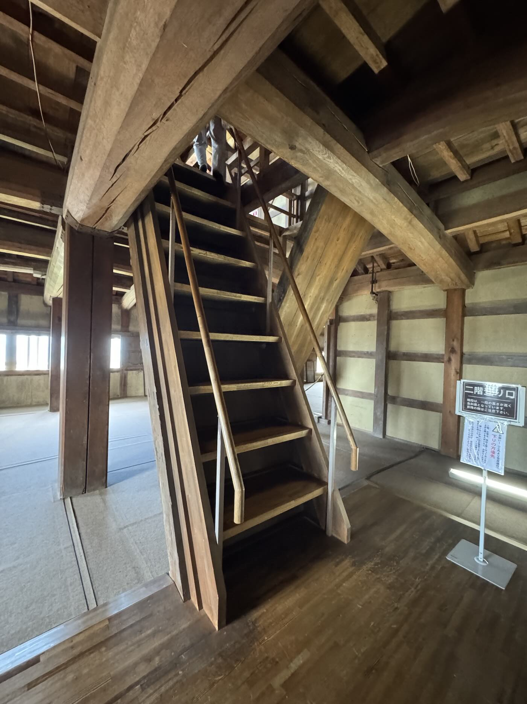

Waiting at the top as a reward for climbing the steps is always a viewpoint where you can get an incredible view of the city and in this case, Lake Biwa.

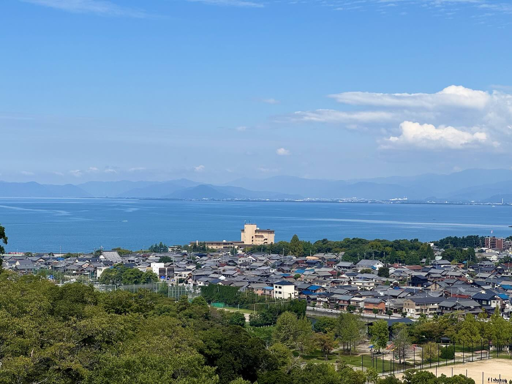

Once I descended from the three-story castle, I proceeded to the traditional Japanese-style garden. The garden at Hikone castle is one of the larger gardens I have been to, complete with a traditional tea house and pond in the middle. The garden was very well kept and a beautiful sight as a result.

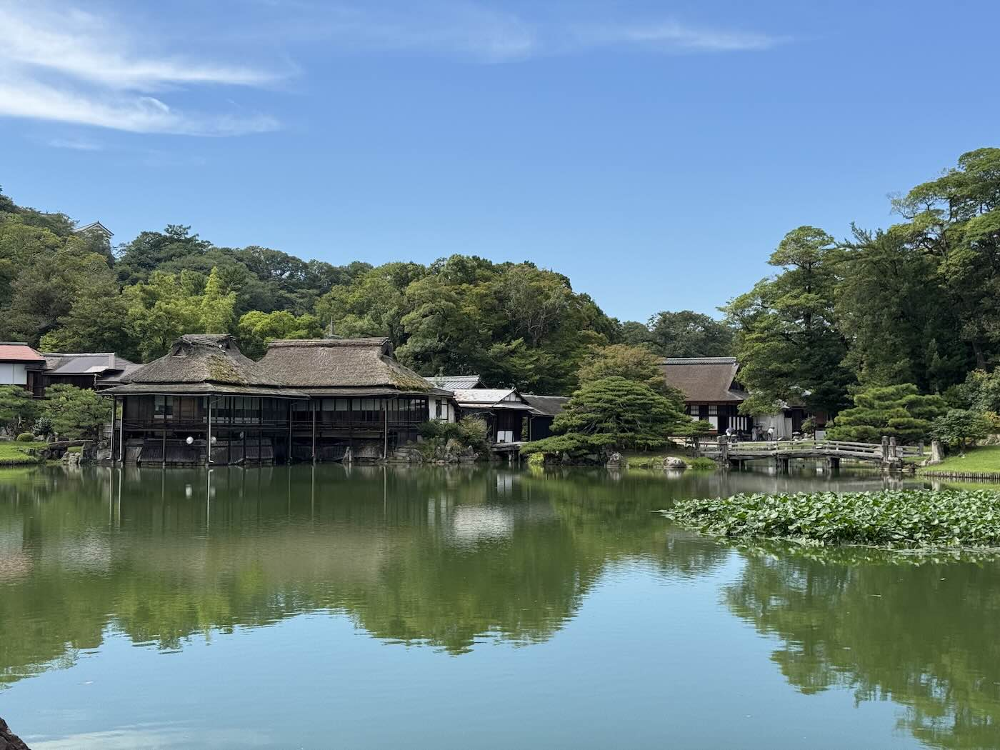

Having seen what would prove to be a highlight of the trip, I boarded a train to Kusatsu, where I transferred to a special express to Akashi. When planning the trip, I was researching which places to stop between Kyoto and Himeji. During this research, I found several larger sations such as Kyoto, Osaka, and Kobe, but each large station required days to explore properly, rather than the few hours per stop this trip was modeled after. I then found Akashi. A smaller city famous for its local dish “Akashiyaki” and the “Akashi Kaikyo Bridge”, among other things. The former being the city’s take on the more famous “Takoyaki” dish. Instead of dressing the dumplings with Takoyaki sauce, onion, mayonnaise, and bonito flakes, it is left plain and dipped in dashi. There are some changes to the dumpling, but it’s quite similar. The latter is a bridge along the highway to Shikoku (one of Japan’s four main islands). 

#### Akashi

I first made my way over to the observation deck for the Akashi Kaikyo Bridge. Along the way, I met a local who was initially confused why I would travel from Tokyo to see the bridge and warned me there wasn’t much to see in Akashi. After explaining my travel plans, she was a little less confused. I continued on anyway as I had already come this far and I’m very glad I did. The observation deck was located underneath the bridge giving a unique perspective.

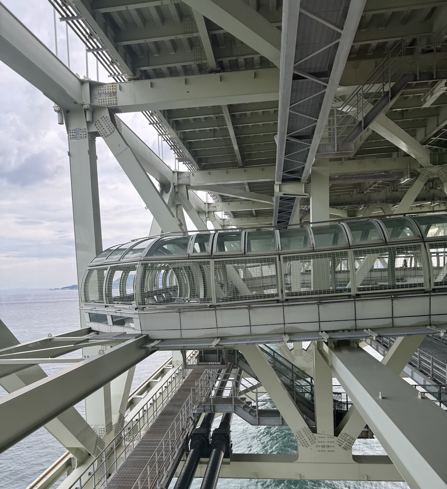

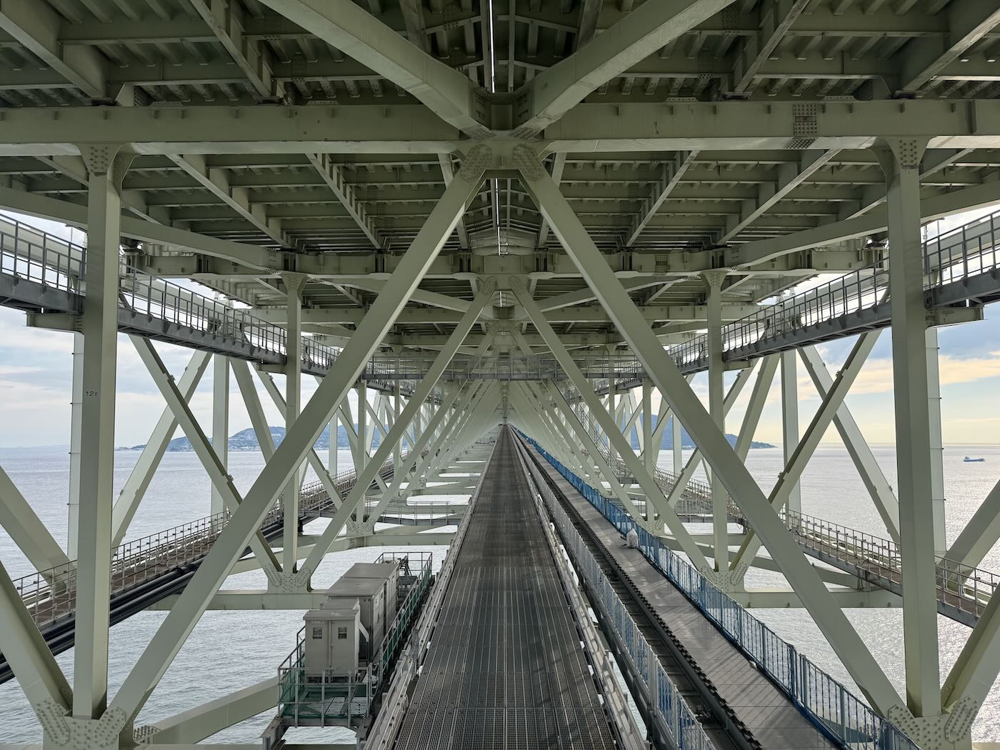

Because of the bridge’s height, you can not only see the impressive engineering required to build the bridge, but also an amazing view of the sea.

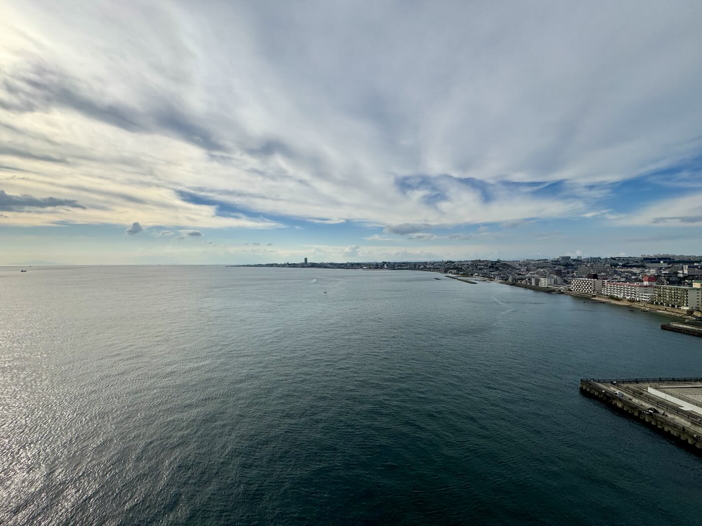

When I had finished exploring the bridge, I made my way back to the Akashi station area to explore the castle grounds. While the castle grounds no longer have a standing castle to explore, the ruins were turned into a hybrid castle ruins historical site and city park with many pathways, ponds, and green areas to explore.

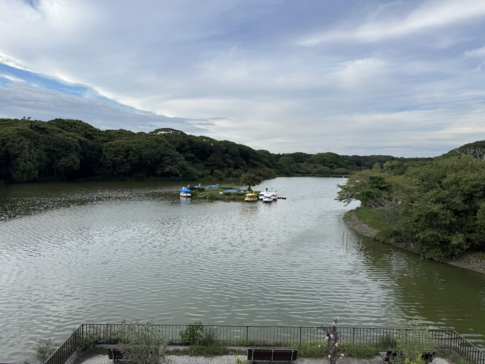

It was also home to a park cat.

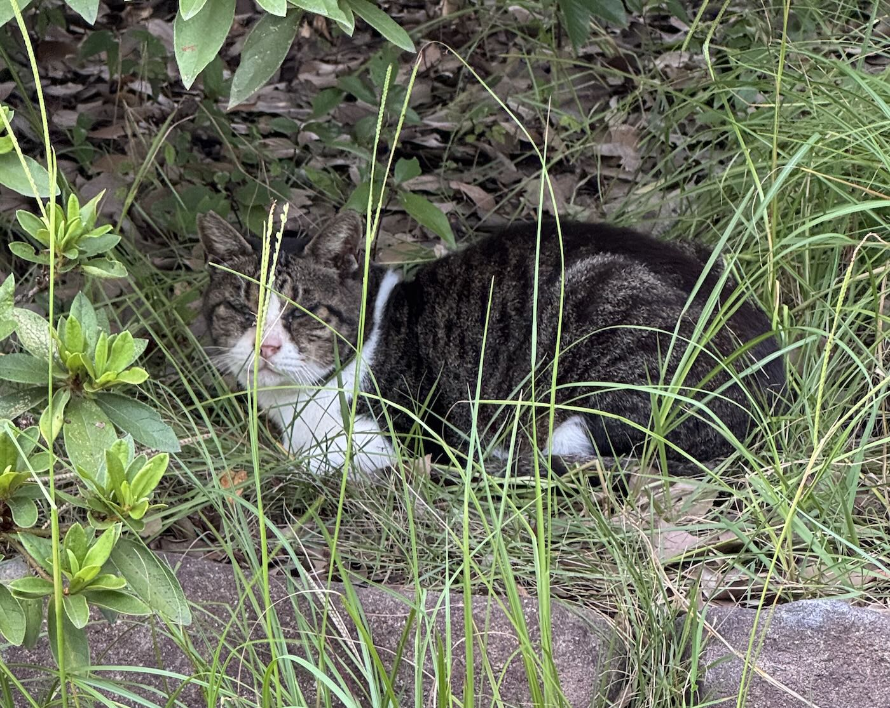

The day I was there, there were several community activities, such as a display showing small portable gardens grown by the locals, hot air balloons, and more.

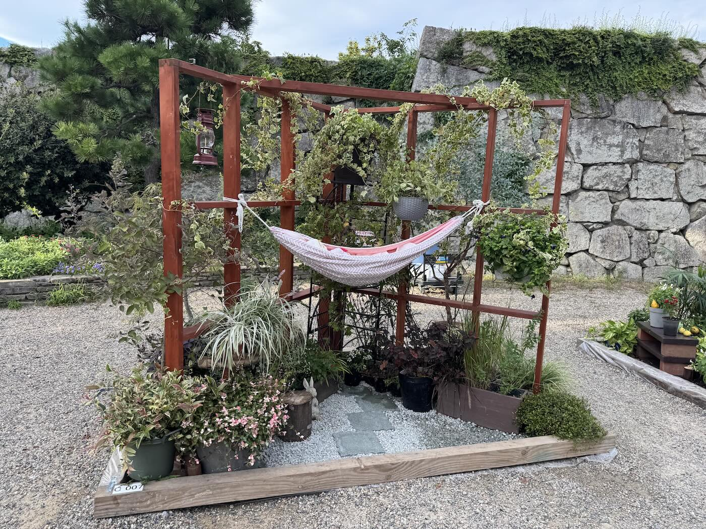

Before taking my next train to Himeji, I had to try Akashiyaki. To be honest, I’ve never been a huge fan of Takoyaki. The mix of flavors doesn’t taste as appealing to me as it does to most. I had already planned on trying Akashiyaki, but when talking to the lady I met before, she suggested I try Akashiyaki, so I knew I definitely had to try it.

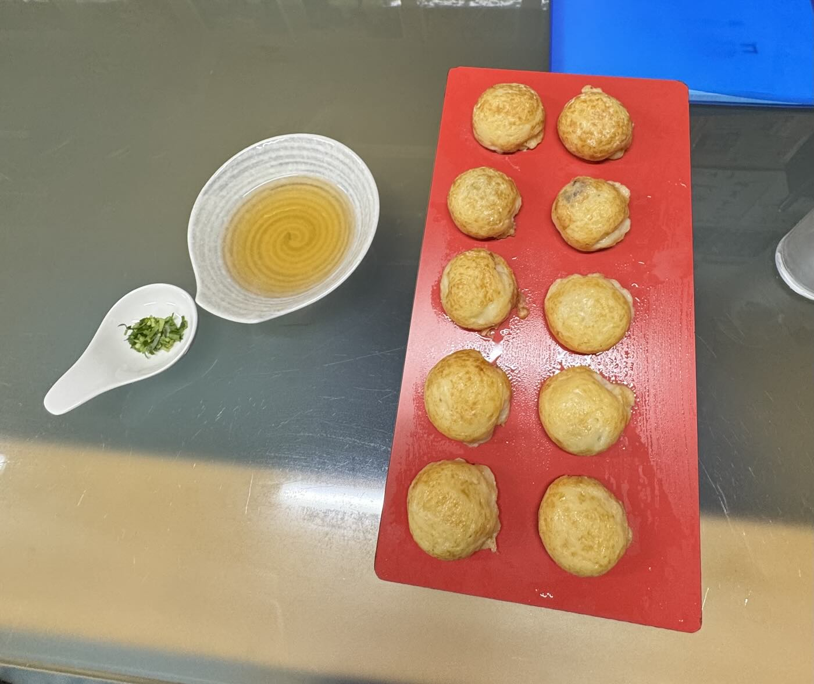

While I may not care for Takoyaki, I really enjoyed Akashiyaki. The restaurant I went to was very kind and they even gave me a Kanji test. If I could write the reading of six out of ten or higher, I would get 10% off. If I got all ten, I would get 20% off my meal. Unfortunately these Kanji were very difficult and I got the incredibly high score of zero out of ten. I would show a picture of the test, however I was requested not to take pictures and obliged with the request.

Next, I made my way to Himeji. By the time I got to Himeji, it was already after dinner time and I was feeling somewhat exhausted, so I rode the local Sanyo Electric Railway down to a Starbucks where I drank a decaf latte and relaxed until my next train to the neighboring town, Aioi, where I stayed the night.

### Trains used on this section

##### Day 0: Numazu - Toyohashi

| Train line | From      | Start | To        | End   |
| ---------- | --------- |:-----:| --------- |:-----:|
| Tokaido    | Kawasaki  | 14:25 | Atami     | 15:49 |
| Tokaido    | Atami     | 15:56 | Numazu    | 16:16 |
| Tokaido    | Numazu    | 18:30 | Hamamatsu | 20:11 |
| Tokaido    | Hamamatsu | 20:13 | Toyohashi | 20:47 |

##### Day 1: Toyohashi - Aioi

| Line            | From      | Start | To      | End   |
| --------------- | --------- |:-----:| ------- |:-----:|
| Tokaido         | Toyohashi | 7:09  | Maibara | 9:10  |
| Biwako          | Nagahama  | 10:29 | Hikone  | 10:34 |
| Biwako          | Hikone    | 13:04 | Kusatsu | 13:41 |
| Kobe/Kyoto line | Kusatsu   | 13:52 | Akashi  | 15:22 |
| Kobe line rapid | Akashi    | 18:10 | Himeji  | 18:35 |
| Sanyo           | Himeji    | 20:38 | Aioi    | 20:59 |

**Next week, I travel to Okayama, Onomichi, Itosaki, Hiroshima, and Iwakuni.**
